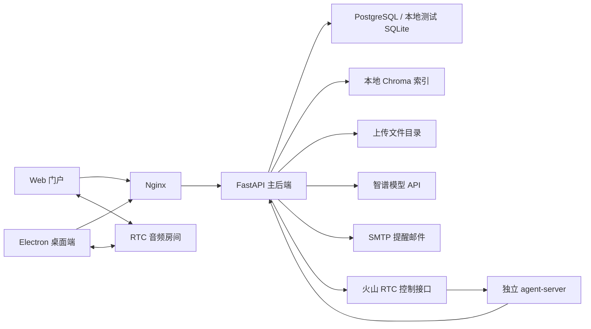

# Detachym 架构与运行边界

依据当前工作区源码复核于 2026-09-27。本文描述代码与运行配置，不表示本轮改动已经部署。

## 系统组成

Detachym 由 Electron 桌面客户端、Web 门户和 FastAPI 主后端组成。主后端是按业务模块组织的异步单体；路由层在部分流程直接访问 SQLAlchemy，并非严格的 Clean Architecture。RTC 场景另有独立的 `agent-server/` 服务。

根目录 `docker-compose.yml` 包含 PostgreSQL、backend、nginx 三个服务。`agent-server/` 使用自己的 Compose 配置接入共享网络；它不是主后端内部线程。入口和本地命令见 [项目说明](../readme.md)，部署步骤见 [部署文档](DEPLOYMENT.md)。

## 模块与职责

| 区域 | 入口 | 职责 |
| --- | --- | --- |
| Web | `frontend/src/App.tsx` | 首页、下载、登录注册、账户、管理与语音 Demo；受保护路由按登录状态和管理员身份展示。 |
| Web 状态与请求 | `frontend/src/stores/`、`services/` | 账号同步、迟到响应隔离、跨标签页登录同步及接口调用；页面和 RTC SDK 按需加载。 |
| 桌面主进程 | `desktop/electron/main.cjs` | 桌宠、快捷聊天、主面板窗口，托盘、系统通知、本地存储、专注计时和提醒唤醒。 |
| 桌面桥接 | `desktop/electron/preload.cjs` | 显式 IPC 接口；窗口启用 `contextIsolation` 并禁用渲染器 Node 集成。 |
| 桌面渲染器 | `desktop/src/pet.jsx`、`quick-chat.jsx`、`main-panel.jsx` | 桌宠互动、快捷聊天、会话与知识库，以及成长、装扮、提醒和回顾面板。 |
| 后端生命周期 | `backend/app/main.py` | 初始化存储、管理员种子、RTC 清理、周期提醒和邮件投递后台任务；退出时依序关闭。 |
| 后端路由 | `backend/app/api/router.py`、`api/v1/` | 认证、用户、管理、聊天、知识库、宠物关系、提醒、RTC、工具和公开发布接口。 |
| 后端业务 | `backend/app/services/` | 模型调用、知识检索、关系成长、提醒生成与投递、RTC 控制。 |
| 关系数据 | `backend/app/models/database.py`、`alembic/` | SQLAlchemy 异步会话、业务模型和迁移。 |
| 语音 Agent | `agent-server/app/main.py` | 接收兼容 Chat Completions 的请求；确定性问题走时间、天气等工具，其他问题通过主后端内部聊天接口。 |

Web 当前没有文本聊天和知识库管理页面；这些入口位于桌面主面板。不要依据早期文档寻找不存在的 Web Chat/Knowledge 路由。

认证和管理员接口中的密码计算通过现有工作线程池运行；数据库会话与写入仍留在请求协程中。线程池并发数沿用框架默认值，没有新增后台密码队列或改变现有密码哈希格式。

Web 的受保护请求在同步拦截阶段绑定当前账户；本地共享 token 与界面状态不一致时先拒绝发送，避免另一标签的账号接收旧页面操作。公开认证和发布信息请求匿名发送。账户、管理员页面的读取与写入结果再核对界面、store 和共享登录状态。

Web 的入口 HTML 自带启动状态与资源失败提示，不依赖应用分包；React 挂载后移除启动监听。路由错误边界位于账号同步组件内，导航变化可离开错误页，同一失败分包由用户手动刷新恢复。Nginx 对 HTML 重新校验缓存，对 `/assets/` 的内容哈希资源长期缓存，缺失资源直接返回 404。

首次偏好初始化使用用户唯一键上的冲突忽略插入，再独立查询最终记录；共享 helper 不自行提交事务。SQLite 与 PostgreSQL使用各自方言，后者依赖默认 READ COMMITTED 的语句级快照；没有用进程锁代替数据库唯一约束。

新建和补建偏好显式使用小猪，已有偏好直接保留；更新接口只写入显式提交的字段。迁移 `015_pig_default_preferences` 只调整 PostgreSQL 列默认值，不重写历史数据。旧 SQLite 表可能仍保留原列默认值，应用创建流程显式传入 `pig`；新建 SQLite 表的 ORM 与服务端默认值均为 `pig`。

## 关键数据流

### 文本聊天

1. 桌面通过 `/chat/message` 发送问题及可选会话、宠物、知识库选项；后端也提供 `/chat/stream` SSE。
2. 指定会话必须属于当前账号且仍存在，只有未指定会话时才新建。
3. 后端保存用户问题，读取会话历史，加入宠物风格和可选知识片段，再调用模型。
4. 完整成功的回答与用户消息的宠物统计标签同次提交，再尝试幂等的关系成长奖励。
5. 模型失败不生成助手历史或成长奖励。同步接口返回错误；已开始的 SSE 以错误终止事件结束。详见 [API 对话契约](API.md#对话接口)。

SSE 生成器自己持有数据库会话；正常结束和客户端断开均关闭会话。客户端仍需区分部分内容、最终完成和失败，不能把 HTTP 200 单独当作整个流成功。

聊天持久化绑定原会话的所有者和创建时间，以及原用户消息的身份快照。保存问题、保存回答与删除会话使用短写事务协调；模型和知识检索等待期间不持有写锁。数据库复用已删除的整数编号时，旧请求会被拒绝。历史按本轮问题截断，避免并发问题改变模型回答目标。

### 知识库

上传文件先检查类型和大小，再保存文档记录与文件；提取 `.txt`、`.md` 或 `.pdf` 文字后分块。当前嵌入实现是本地词元哈希和归一化向量，不是外部语义嵌入 API，也没有使用 LangChain 构建索引链。

写入和删除均遵守实际 Chroma 客户端的批次上限。部分写入失败会尝试删除残留索引；失败文档保留为可见记录，用户可以检查后删除重传。检索按用户 ID 过滤，原文件、文档记录与向量索引属于三种存储资源。

检索跳过没有有效词元的零向量问题，并过滤无正相关的余弦候选。可信提示词与检索资料分开：文件名、文档原文使用 JSON 数据消息，用户问题单独传递，资料中的文字不会直接拼进系统角色。删除后新查询不再召回原文档；已经开始的模型生成仍可能使用此前的上下文快照。

耗时提取、索引、检索和向量删除在工作线程中执行。同一账号的上传、删除、管理员删号由进程内异步锁协调；索引读写由线程锁保护。这些锁不提供跨进程事务，也不等于可以任意增加服务副本。

### 提醒与专注

桌面预取近期待办，把最近截止时间交给主进程。主进程计时器只负责唤醒，不保存提醒正文或账号凭据；桌宠收到唤醒后重新核对服务端状态，再显示提醒、请求系统通知并回写触发状态。触发与用户完成是不同状态。

周期提醒由后端后台任务生成实例，邮件投递使用数据库租约和原子领取；取消或更新后，过期租约的回写不能覆盖新状态。系统通知送达后若触发回写失败，仍可能重投，不能据此承诺跨设备恰好一次送达。

聊天里的相对提醒在桌面本地解析，按实际经过时长生成 UTC 截止时间；不完整或冲突表达保留草稿，由用户修改。“待提醒”面板读取未触发的 pending 记录，仅显示一次性事项；改期使用设备本地时间输入并提交 ISO 时间，取消复用现有 PATCH。列表和操作响应受账号上下文保护，改动后重新安排桌宠唤醒。后端触发使用单条条件更新检查归属、pending 和已到期，改期强制清空触发标记，避免迟到请求消耗未来提醒；它无法撤回已经显示的系统通知。

“陪我专注”由 Electron 主进程计时，按服务地址、用户和宠物保存在本机，重启按实际截止时间恢复。它不代表云端专注历史。专注期间暂停小猪主动闲聊，已有重要提醒照常处理。

### RTC 语音

客户端请求后端创建会话，使用临时 RTC 凭据入房并发布音频；后端启动火山 VoiceChat 控制面。独立 Agent 服务处理模型和工具请求，结果经 RTC/TTS 回到客户端。会话退出同时涉及本地音频资源和远端控制面，断网时远端停止属于尽力清理。

RTM、入房、音轨发布、AI 入房、音频接收及停止回执是不同环节；本地模拟验证不能代替真实麦克风和云端 RTC 验收。接入细节见 [语音设置](VOICE_DEMO_SETUP.md) 和 [Agent 服务说明](../agent-server/README.md)。

## 存储、部署与验证

- 默认关系数据库连接为 PostgreSQL；根 Compose 也运行 PostgreSQL。SQLite 用于本地隔离测试及验收，其初始化兼容路径不同于生产 Alembic 迁移。
- 文件与 Chroma 索引由 `UPLOAD_DIR`、`CHROMA_PERSIST_DIR` 指定。迁移或备份时应同时考虑业务数据库、文件和向量索引，不能仅复制一个 SQLite 文件。
- 模型实现当前只注册智谱 provider，默认模型名由 `ZHIPU_MODEL` 配置。没有自动切换到 DeepSeek 的已实现路径。
- 后台提醒与 RTC 清理任务随主应用生命周期启动。多副本部署需要进一步验证任务协调、存储共享与迁移竞争，本项目现有进程锁不能替代分布式协调。
- `/health` 是进程存活检查；`/health/ready` 检查数据库可查询及存储目录存在，不证明 SMTP、模型或 RTC 云服务可用。
- 本轮验证命令、实际结果与未验证项见根目录 [产品优化与验证记录](../本轮产品优化与验证.md)。现有 RC2 安装包不自动包含后来修改的源码。
